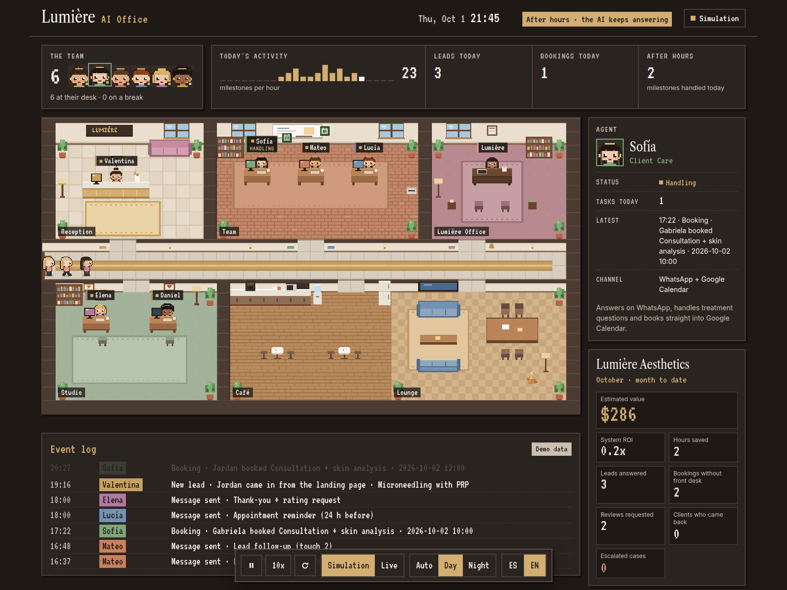
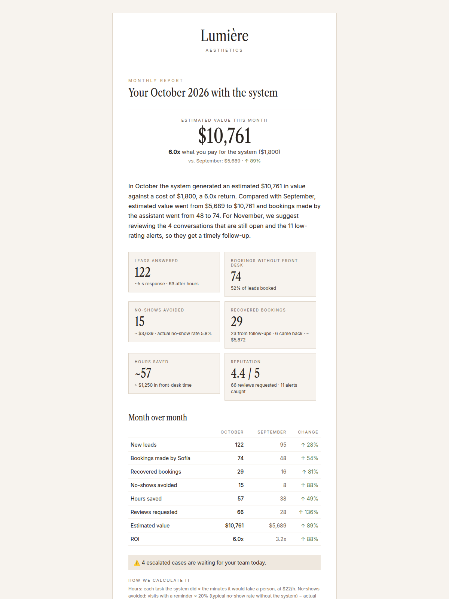
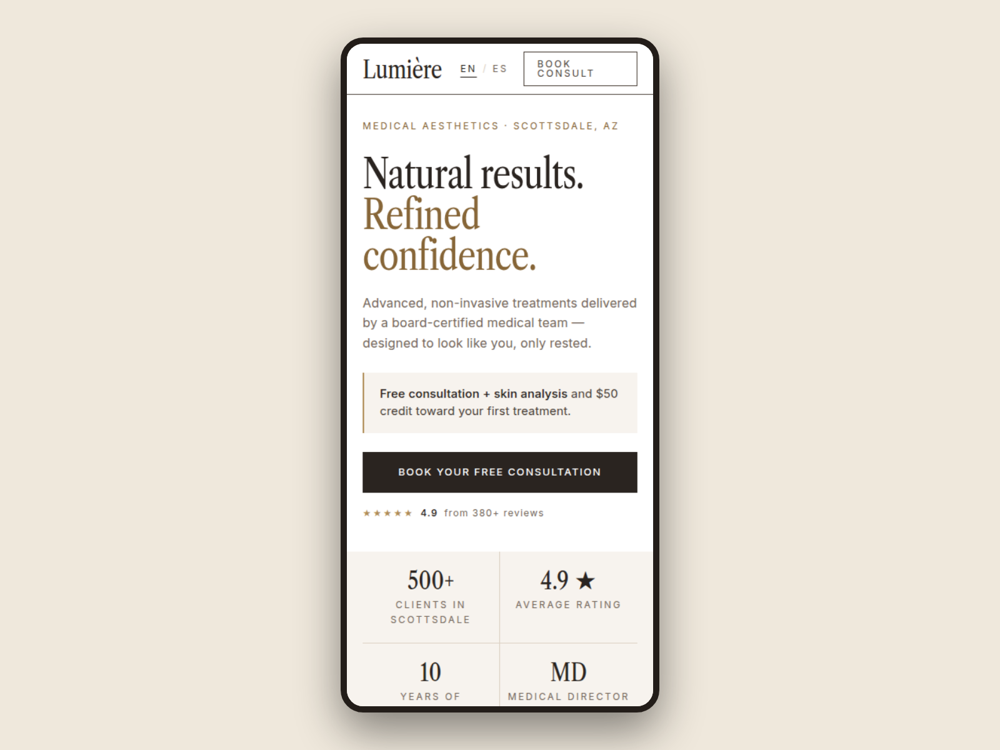

# Lumière Aesthetics: sistema de automatización con IA para un med spa

[🇬🇧 English](README.md) | 🇪🇸 Español

Un sistema de automatización completo y funcionando para un med spa, desde el primer mensaje hasta que la clienta vuelve tres meses después. **Lumière Aesthetics es un negocio de demostración** (un med spa ficticio en Old Town Scottsdale, Arizona), pero cada parte se construyó y se probó de punta a punta como si fuera un cliente que paga: mensajes de WhatsApp reales, citas reales en Google Calendar, reportes reales.

**Demos en vivo**
- **Oficina de IA** (todo el sistema funcionando, con un mes de demostración simulado): https://lumiere-office.pages.dev
- **Landing page**: https://lumiere-aesthetics.pages.dev



---

## El problema

Un med spa paga por cada lead y después pierde plata en los mismos lugares:

- Los leads que llegan a las 9 p. m. o un domingo esperan hasta el día siguiente, y agendan en otro lado.
- Agendar toma varios mensajes de ida y vuelta con la recepción.
- Se pierde entre el 15 y el 20 % de las citas por clientas que simplemente olvidan.
- Las clientas contentas nunca dejan reseña; las molestas la dejan en público.
- Las clientas antiguas se alejan y nadie les recuerda que ya toca su siguiente tratamiento.
- La dueña paga por automatización, pero no tiene números para saber si le sirve.

## El recorrido de la clienta (lo que hace el sistema)

1. **Llena el formulario** de la landing, a cualquier hora.
2. **Le llega un WhatsApp en segundos.** Un agente de IA le resuelve las dudas con los precios y horarios reales del spa.
3. **Agenda en el mismo chat.** El agente consulta Google Calendar y agenda, reprograma o cancela. Si se queda callada, una secuencia de seguimiento la trae de vuelta.
4. **Recordatorios antes de la cita** (48 h, 24 h, 2 h): confirma, reprograma o cancela en un mensaje.
5. **La atiende el equipo del spa.** El único paso 100 % humano.
6. **Agradecimiento + calificación.** Una nota alta recibe el link de reseña en Google; una baja le avisa primero a la dueña.
7. **Queda en la lista de contacto.** Recordatorios de retoque (botox cada 3-4 meses), ofertas y reactivación si deja de venir.

## Las 7 partes

Cada parte funciona y se vende sola. Juntas operan como un solo sistema y comparten las mismas piezas.

| # | Parte | Qué ahorra |
|---|---|---|
| 1 | [Captura de leads: landing + registro del lead](01-lead-capture) | Ningún lead se pierde, llegue a la hora que llegue |
| 2 | [Agente de IA por WhatsApp que atiende y agenda](02-whatsapp-ai-agent-booking) | Responde en ~3 s, 24/7, y agenda sin recepcionista |
| 3 | [Seguimiento a leads que no agendan](03-lead-nurture) | Recupera leads que se enfriarían |
| 4 | [Recordatorios de citas y anti no-shows](04-appointment-reminders) | Menos sillas vacías |
| 5 | [Post-servicio y reputación online](05-post-service-reviews) | Más reseñas buenas, las malas se atajan a tiempo |
| 6 | [Retención y reactivación de clientas](06-retention-reactivation) | Clientas que vuelven sin pagar publicidad |
| 7 | [Sistema completo + reportes a la dueña + oficina de IA](07-full-system-owner-reports) 🏆 | La prueba en dólares de todo lo anterior |

## Resultados (mes de demostración)

Datos de demostración generados y procesados con las mismas hojas y los mismos reportes que recibe la dueña:

| | Septiembre | Octubre |
|---|---|---|
| Leads nuevos (respuesta promedio ~5 s, la mitad fuera de horario) | 95 | 122 |
| Citas agendadas por el asistente, sin recepción | 48 | 74 |
| Citas recuperadas (seguimiento + clientas que volvieron) | 16 | 29 |
| No-shows evitados | 8 | 15 |
| Horas de recepción ahorradas | 38 | 57 |
| **Valor estimado** | **$5,689** | **$10,761** |
| **ROI frente a una mensualidad de $1,800** | **3.2x** | **6.0x** |

<p>
  
  
</p>

## Cómo está construido

- **n8n (self-hosted)** corre todos los workflows. Los sub-workflows compartidos (contexto de la clienta, enviar WhatsApp, disponibilidad, agendar, enviar correo) los reutilizan todas las partes, así que nada se duplica.
- **Claude API**: Sonnet para todo lo que habla con las clientas y para los agentes, con prompt caching en los system prompts largos. n8n calcula (horarios libres, métricas) y Claude decide; Claude nunca inventa disponibilidad ni números.
- **Twilio WhatsApp** como canal. El bloque de envío está desacoplado, así que el mismo sistema funciona por SMS.
- **Google Calendar** para la agenda del spa y **Google Sheets** como base de datos: una pestaña por entidad (Leads, Conversaciones, Citas, Seguimientos, Calificaciones, Escalamientos), unidas por `lead_id`. Lista para pasar a Postgres (cada pestaña = una tabla).
- **Escalamiento a una persona en exactamente 5 casos**: pide hablar con alguien, tema médico, queja, pedido de dinero inusual o el agente no sabe qué hacer.
- **Cloudflare Pages** para la landing y la oficina de IA.

## Estructura del repositorio

```
01-lead-capture/                 README, workflows (captura + alerta de errores) y la landing
02-whatsapp-ai-agent-booking/    README y 7 workflows (agente + piezas compartidas)
03-lead-nurture/                 README y 3 workflows (secuencias, baja, correo compartido)
04-appointment-reminders/        README y workflow
05-post-service-reviews/         README y 2 workflows
06-retention-reactivation/       README y workflow
07-full-system-owner-reports/    README, 5 workflows y la oficina de IA (sitio estático)
docs/screenshots/
```

Cada parte tiene un `README.md` (inglés) y un `README.es.md` (español) con el problema, la solución, los resultados de las pruebas y los aprendizajes técnicos.

**Nombres de los workflows.** Dentro de n8n cada workflow lleva un prefijo corto (por ejemplo `P31b - Lumière WhatsApp Inbound`) para que los de cada parte queden juntos. Los README usan los mismos prefijos cuando hablan de un workflow concreto: P30 = parte 1, P31 = parte 2 … P36 = parte 7.

**Importar un workflow.** n8n → *Import from file* → elige el `.json`. Todos los IDs, teléfonos, correos y credenciales son placeholders (`YOUR_...`): reemplázalos y conecta tus propias credenciales (Twilio, Google, Anthropic).

## Sobre mí

Construido por **Alejandro Arroyave**, AI Automation Engineer. Construyo agentes de IA y automatizaciones con n8n, Claude, Twilio y Google Workspace para empresas que quieren quitarle el trabajo repetitivo a su equipo.

- Upwork: https://www.upwork.com/freelancers/~013fd3979d1da5ff68
